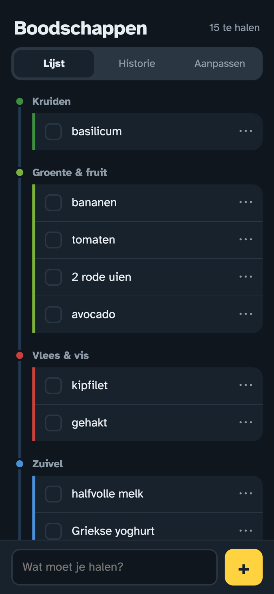
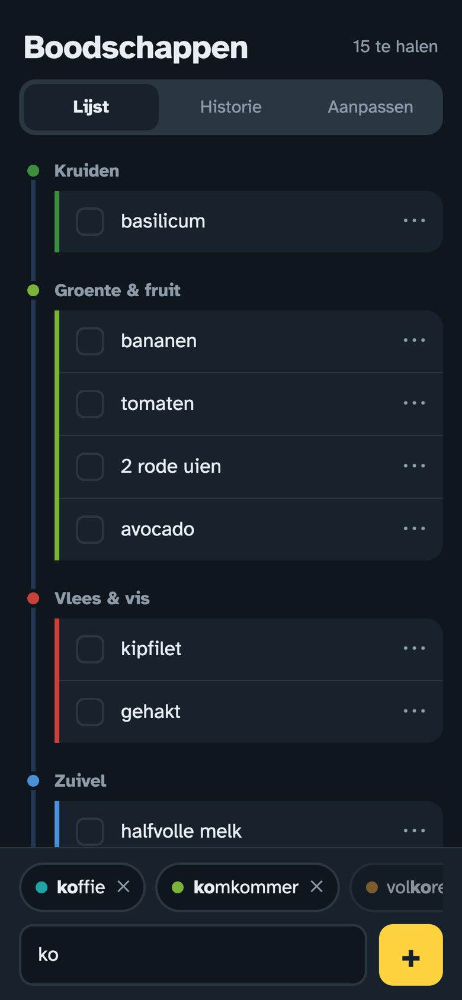
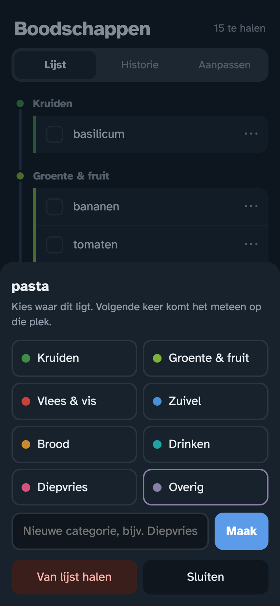
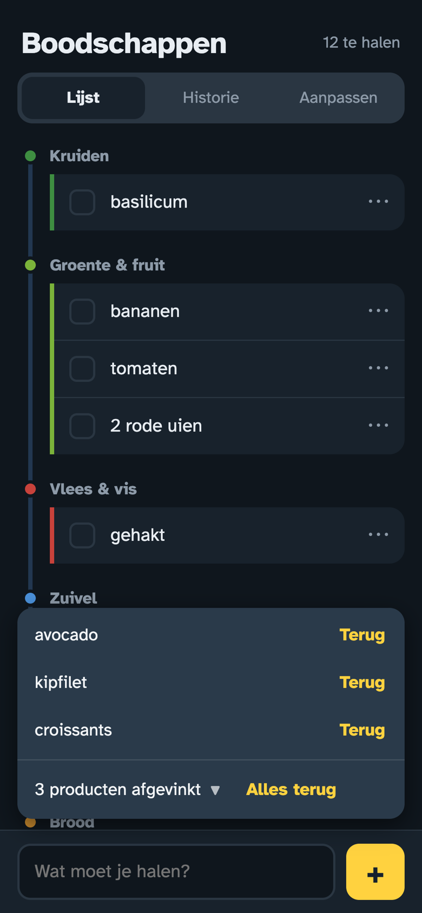
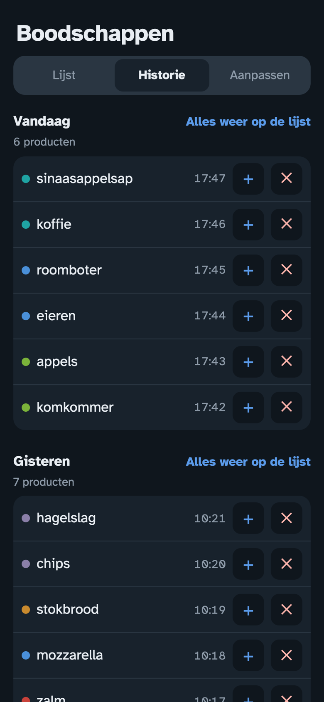
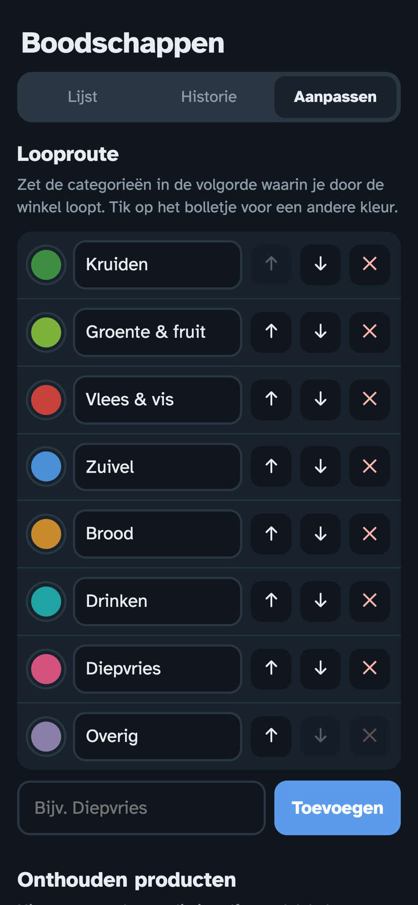
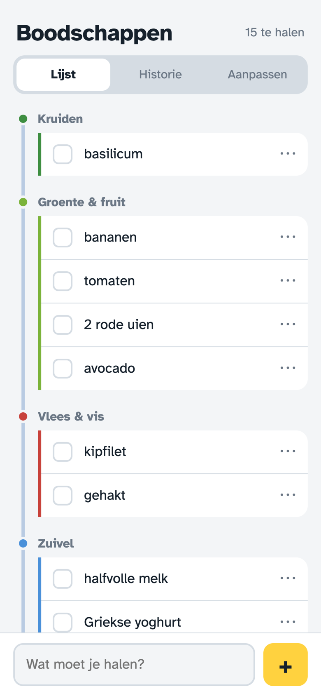
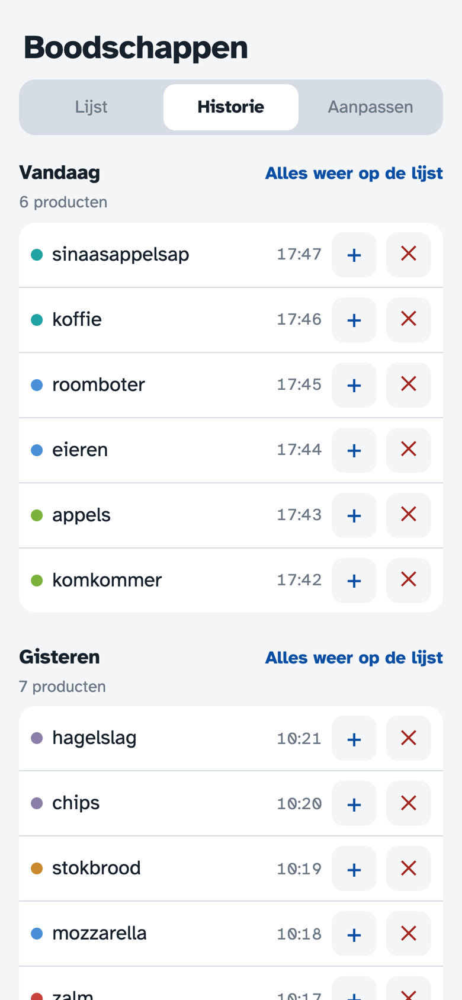

# Boodschappenlijst (self-hosted)

Sorteert automatisch op looproute: Kruiden → Groente & fruit → Vlees & vis → Zuivel → Brood → Drinken → Overig.

<table>
  <tr>
    <td align="center"> Vanzelf in de volgorde van je looproute</td>
    <td align="center"> Suggesties van eerder gekochte producten</td>
    <td align="center"> Staat iets verkeerd? Kies de juiste plek</td>
  </tr>
  <tr>
    <td align="center"> Afvinken, en even kunnen terugzetten</td>
    <td align="center"> Historie per dag, met één tik weer op de lijst</td>
    <td align="center"> Je eigen looproute en kleuren</td>
  </tr>
  <tr>
    <td align="center"> Licht of donker, net als je telefoon</td>
    <td align="center"> &nbsp;</td>
    <td></td>
  </tr>
</table>

## Starten als stack (Portainer of docker compose)
Gebruik `stack.yml`: die haalt het kant-en-klare image op, bouwen is niet nodig.
In Portainer: Stacks → Add stack → plak de inhoud van `stack.yml` → Deploy.
Of op de server: `docker compose -f stack.yml up -d`

## Zelf bouwen
    docker compose up -d --build
Open daarna http://<ip-van-je-server>:2020 op je telefoon en kies "Zet op beginscherm".

## Gebruik
- Typ een product en druk op +. Hoeveelheden mogen ("2 kg aardappelen").
- Eerder getypte producten verschijnen als suggesties boven het invoerveld. Tik erop om ze meteen toe te voegen. Met een leeg veld zie je wat je vaak koopt. Met ✕ haal je een suggestie weg (handig bij typfouten).
- **Productherkenning**: tikfouten worden verbeterd ("komkomer" wordt komkommer, "advokado" wordt avocado) en daarna in de juiste categorie gezet. Klopt de verbetering niet, tik dan op "Toch …" in de melding: de naam blijft zoals je hem typte en dat woord wordt voortaan niet meer verbeterd. Herkend worden ruim 1.400 gangbare supermarktproducten (`categories.py` en `products.py`) plus alles wat je zelf een categorie hebt gegeven.
- Tik op een product om af te vinken. Het verdwijnt van je lijst (even "Ongedaan maken" kan) en komt in de Historie.
- **Historie**: alles wat je hebt afgevinkt, per dag. Zet losse producten of een hele dag in één keer weer op je lijst.
- **Recept toevoegen**: tik op het 🔗-knopje naast het invoerveld en plak de link van een recept (of plak de link gewoon in het invoerveld). De ingrediënten worden uitgelezen, zonder hoeveelheden ("2 tenen knoflook, geperst" wordt knoflook). Je ziet ze eerst en kiest zelf wat op de lijst komt; zout, peper en water en wat al op je lijst staat, staan standaard uit. Werkt met de meeste receptsites (Leukerecepten, 24Kitchen, Jumbo, foodblogs). Sommige sites, zoals Allerhande, laten zich niet automatisch uitlezen: kopieer dan de ingrediënten van de pagina en plak ze in het venster.
- Staat iets verkeerd? Tik op ⋯ en kies de juiste categorie. Dat wordt onthouden.
- Meerdere telefoons blijven vanzelf in sync.

## Aanpassen
- Volgorde of trefwoorden: `categories.py`, de uitgebreide productenlijst staat in `products.py` (daarna `docker compose up -d --build`).
- Nieuwe categorie: voeg hem toe in `categories.py` en geef hem een kleur in `static/index.html` (`--c-<sleutel>`).
- Data staat in `./data/boodschappen.db`.

## Zelf aanpassen (knop "Aanpassen" rechtsboven)
- **Looproute**: zet categorieën met ↑ ↓ in je eigen volgorde, hernoem ze, geef ze een kleur, voeg nieuwe toe (bijv. Diepvries) of verwijder ze.
- **Onthouden producten**: zie welke producten je zelf een plek hebt gegeven, verander de categorie, vergeet ze, of leer vooraf een nieuw product aan.
- Vanuit de lijst kan het ook snel: ⋯ bij een product → kies categorie of maak direct een nieuwe.

## Inloggen
Zet een wachtwoord met de omgevingsvariabele `APP_PASSWORD` (in `stack.yml` of `docker-compose.yml`) en start de container opnieuw. Iedereen deelt dat wachtwoord en dezelfde lijst.
- Elk apparaat logt één keer in en blijft een jaar ingelogd. Uitloggen kan onderaan **Aanpassen**.
- Wachtwoord veranderd? Dan moeten alle apparaten opnieuw inloggen.
- Na 5 verkeerde pogingen moet je even wachten, en steeds langer bij nieuwe fouten.
- Draait de app via https (bijv. achter een reverse proxy), zet dan ook `COOKIE_SECURE=true`.
- Zonder `APP_PASSWORD` werkt alles zoals vroeger, zonder inloggen.

## Versies
Elke release krijgt een eigen image, bijv. `ghcr.io/richrdj/boodschappenlijst:1.3.0`.
`latest` is altijd de nieuwste versie. Wil je niet automatisch meegaan, zet dan een vast versienummer in `stack.yml`.
